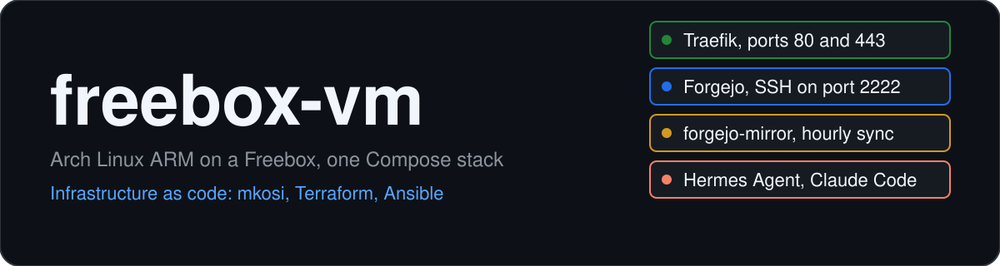
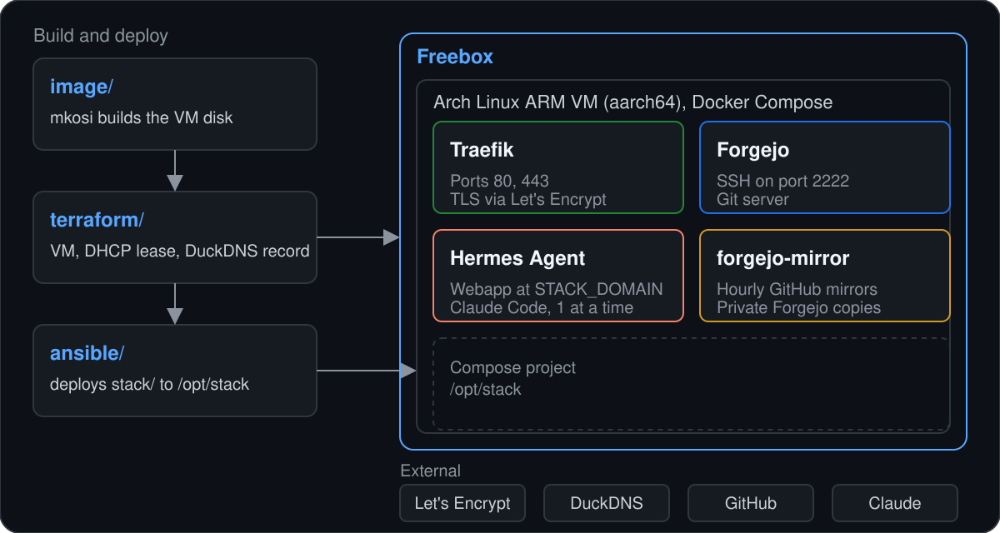

# freebox-vm



Infrastructure for an Arch Linux ARM VM on a Freebox, running Traefik, Gogs, Doco-CD, gogs-mirror and Hermes Agent in one Docker Compose stack. Hermes runs on your Claude subscription through Claude Code at `STACK_DOMAIN`, and Gogs at `git.STACK_DOMAIN`.

## Architecture



| Directory | Role |
|---|---|
| `image/` | Builds the VM disk with mkosi |
| `terraform/` | Creates the VM and network objects on the Freebox, and the DuckDNS record |
| `ansible/` | Deploys `stack/` to `/opt/stack` on the VM |
| `stack/` | Docker Compose stack: Traefik, Gogs, Doco-CD, gogs-mirror, Hermes Agent |

## Configuration

| Variable | Meaning |
|---|---|
| `FREEBOX_ENDPOINT`, `FREEBOX_APP_ID`, `FREEBOX_TOKEN` | Freebox API address, app ID and app token; read by Terraform |
| `DUCKDNS_TOKEN` | DuckDNS account token; read by the update script, never stored in Terraform state |
| `FREEBOX_VM_HOST`, `FREEBOX_VM_SSH_KEY` | VM address and path to the SSH private key |
| `STACK_DOMAIN` | Public DNS name, for example `example.duckdns.org`; `git.` must resolve too |
| `HERMES_USER`, `HERMES_PASSWORD`, `HERMES_SESSION_SECRET` | Hermes Webapp sign-in; secret from `openssl rand -hex 32` |
| `GOGS_ADMIN_USER`, `GOGS_ADMIN_PASSWORD`, `GOGS_ADMIN_EMAIL`, `GOGS_SECRET_KEY` | Gogs admin account; secret from `openssl rand -hex 32` |
| `DOCO_POLL_URL`, `DOCO_GIT_TOKEN` | Deployment repository polled by Doco-CD, for example `http://gogs:3000/<user>/<repo>.git`, and a Gogs token for it; Doco-CD starts only when `DOCO_POLL_URL` is set |
| `GITHUB_MIRROR_TOKEN` | Read-only GitHub token (`Contents: read`, `Metadata: read` on all repositories); `gogs-mirror` creates an hourly, private Gogs pull mirror of every owned, non-fork, non-archived repository, and starts only when the token is set |
| `terraform/terraform.tfvars` | Non-secret Terraform inputs: `ssh_public_key`, `duckdns_subdomain`, `image_server_url`, and optional `hostname`, `freebox_storage_dir`, `lan_ip`, `freebox_public_ipv4`, sizing |

## Ports

| Port | Service |
|---|---|
| 80, 443 | Traefik; certificates from Let's Encrypt (TLS-ALPN challenge) |
| 2222 | Gogs SSH |

## Ansible playbooks

| Playbook | Effect |
|---|---|
| `ansible/playbooks/update.yml` | `pacman -Syu`, reboot if the running kernel was replaced |
| `ansible/playbooks/stack.yml` | Deploys `stack/` to `/opt/stack`, creates the Gogs admin, installs Claude Code and the Hermes Claude subscription plugin |

## Setup

1. Build the VM image, about 2 min (needs Docker):
   ```sh
   image/build.sh
   ```
2. Install Terraform:
   ```sh
   brew install hashicorp/tap/terraform
   ```
3. Fill the variables:
   ```sh
   cp .env.example .env
   ```
   Then edit `.env`.
4. Load them:
   ```sh
   set -a; . ./.env; set +a
   ```
5. Copy the Terraform inputs:
   ```sh
   cp terraform/terraform.tfvars.example terraform/terraform.tfvars
   ```
   Then edit it.
6. Serve the image on the LAN at `image_server_url`, in a second terminal, until step 8 finishes:
   ```sh
   python3 -m http.server -d image/out 8000
   ```
7. Initialise Terraform:
   ```sh
   terraform -chdir=terraform init
   ```
8. Create the VM, disk, DHCP lease, port forwards and DuckDNS record:
   ```sh
   terraform -chdir=terraform apply
   ```
9. Set `FREEBOX_VM_HOST` to the `vm_lan_ip` output, then repeat step 4.
10. Install Ansible:
    ```sh
    brew install ansible
    ```
11. Install the collections:
    ```sh
    ansible-galaxy collection install -r ansible/requirements.yml
    ```
12. Enter the directory:
    ```sh
    cd ansible
    ```
13. Apply, in order:
    ```sh
    ansible-playbook playbooks/update.yml playbooks/stack.yml
    ```
14. Log Claude Code in to your Claude subscription, once:
    ```sh
    ssh -t <user>@<vm> sudo docker compose --project-directory /opt/stack exec -u 10000 hermes /opt/data/claude-cli/bin/claude auth login
    ```

## Limits

- The remote user is `freebox` and needs passwordless `sudo`.
- Let's Encrypt must reach ports 80 and 443 on both names; a shared Freebox IPv4 cannot forward them.
- Gogs reserves the user name `admin`; pick another `GOGS_ADMIN_USER`.
- Doco-CD deploys whatever its repository describes through the Docker socket; only point it at a repository you control.
- Gogs stores `GITHUB_MIRROR_TOKEN` in plain text in the remote URL of each mirror of a private GitHub repository; use a read-only, fine-grained token.
- New mirrors are created private. An existing Gogs repository with the same name is never modified; if it is public, `gogs-mirror` logs it, and you make it private in its Gogs settings.
- Mirrors are never deleted: a repository removed, archived or turned into a fork on GitHub stays in Gogs.
- Hermes runs on the Claude subscription through Claude Code. `extra_usage: stop` with a 97 % reserve refuses requests near the plan limit, but one request can still cross it and bill usage credits; turn usage credits off in the Claude account settings to rule out extra charges.
- Hermes runs one Claude Code process at a time (`max_concurrent: 1`); each one uses about 250 MB of RAM. The stack peaks near 2 GB.
- Terraform state is local at `terraform/terraform.tfstate` and is gitignored. Back it up; without it, the Freebox objects must be imported by hand.
- `freebox_storage_dir` starts with a disk that must already exist on the Freebox (for example an attached SSD); Terraform creates only the folders below it.
- `terraform plan` reads `image/out/freebox-vm.qcow2` to compute its checksum; build the image first.
- The image sets no root password and no console login; access is SSH with the cloud-init key only.
- `disk_size_gib` defaults to 16; raise it and restart the VM, and cloud-init grows the root filesystem at boot.
- The DuckDNS record is updated only on `terraform apply`. If the Freebox public IPv4 changes, apply again. Leave `freebox_public_ipv4` empty only when applying from the home network, because DuckDNS then records the requesting address.
- Enable Full Stack IP in Freebox settings before the first apply; the provider docs say the full port range needs it.
- Get `FREEBOX_APP_ID` and `FREEBOX_TOKEN` from the provider's `authorize` mode, then approve the app on the Freebox screen.
